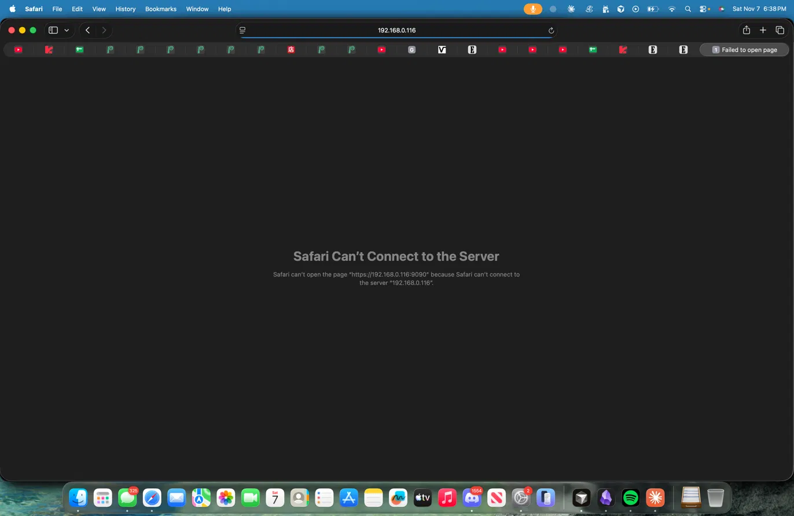
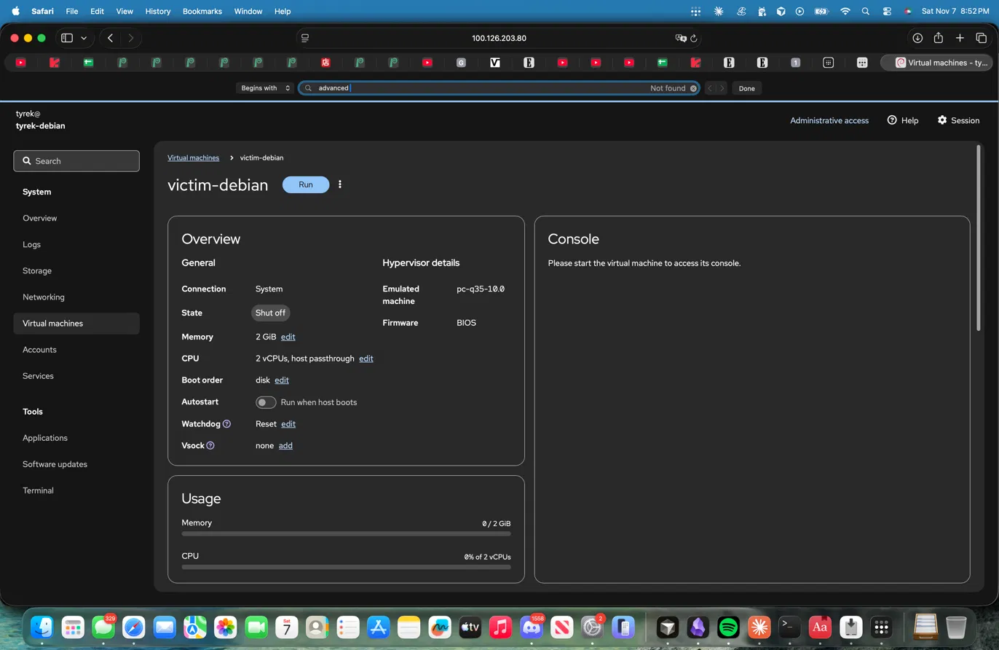
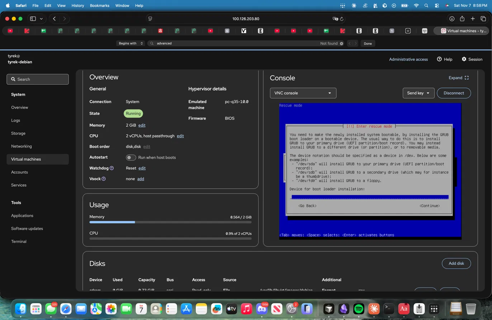
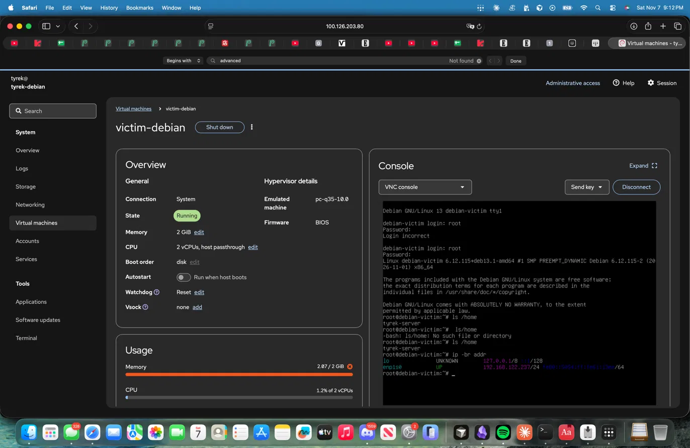

# Laptop Homelab Server 1

> My first homelab: a Debian laptop turned into a KVM virtualization host, built before moving to a dedicated mini PC and rack setup.

**Date built:** November 7, 2026
**Status:** Retired (host laptop traded in, Nov 2026). The lab is being rebuilt on a mini PC.

## About This Project

This was my first attempt at building a homelab, and it didn't go smoothly, which is why I'm documenting it this way. Instead of only showing the finished setup, I've included the problems I ran into and how I worked through them: a port conflict between two services, a router blocking my devices from talking to each other, and a VM that wouldn't boot. For each one, I narrowed down the cause step by step with diagnostic commands before applying a fix. I'm sharing the mistakes on purpose, because they show how I troubleshoot and how much I learned getting from a broken setup to a working one.

---

## Overview

I converted my Acer laptop running Debian 13 (KDE) into a virtualization host for hands-on IT and security practice. The goal was a "defender" environment: an isolated server VM I could harden, monitor, and later attack from another machine.

### What I built

| Component | What it does |
|---|---|
| **Hypervisor host** | Acer laptop running KVM/QEMU with libvirt |
| **Management** | Cockpit web dashboard (port 9090), used from my MacBook |
| **Remote access** | Tailscale VPN, a workaround for my router blocking device-to-device Wi-Fi traffic |
| **Network services** | Pi-hole (DNS filtering) and Docker |
| **Lab network** | `192.168.122.0/24`, an isolated NAT segment for VMs |
| **First VM** | `victim-debian` running Debian 13 as a headless server (2 GB RAM, 20 GB disk) |

### Hardware

| Spec | Value |
|---|---|
| CPU | AMD Ryzen 5 5500U (6 cores / 12 threads, AMD-V enabled) |
| RAM | ~7 GB usable |
| Storage | 238 GB NVMe |
| OS | Debian 13 (KDE Plasma) |

### Topology

```
MacBook Air ──(Tailscale VPN)──> Acer host (Debian 13, KVM/libvirt)
                                   ├── Cockpit :9090
                                   ├── Pi-hole (bound to wlp4s0)
                                   ├── Docker
                                   └── virbr0 (192.168.122.0/24, NAT)
                                         └── victim-debian (Debian 13 server)
```

---

## Build Steps

### 1. Checked the hardware

I confirmed the CPU supported hardware virtualization and checked RAM and disk space.

```bash
lscpu | grep -E "Model name|Virtualization|^CPU\(s\)"; free -h; lsblk -d -o NAME,SIZE,TYPE
```

RAM was the bottleneck. With KDE running, there was room for about one 2 GB VM at a time.

### 2. Base system setup

Updated the system, installed basic tools, and turned on a firewall that only allowed SSH.

```bash
sudo apt update && sudo apt full-upgrade -y
sudo apt install -y openssh-server ufw curl git htop net-tools
sudo systemctl enable --now ssh
sudo ufw allow OpenSSH
sudo ufw enable
```

### 3. Installed the hypervisor

```bash
sudo apt install -y qemu-system-x86 qemu-utils libvirt-daemon-system libvirt-clients virt-manager ovmf
sudo usermod -aG libvirt,kvm $USER
sudo systemctl enable --now libvirtd
```

Verified KVM loaded:

```bash
lsmod | grep kvm && virsh -c qemu:///system list --all
```

### 4. Installed Cockpit

```bash
sudo apt install -y cockpit cockpit-machines
sudo ufw allow 9090/tcp
```

### 5. Created the VM

Created `victim-debian` in Cockpit: Debian 13, 2 GiB RAM, 20 GiB qcow2 disk, on the default NAT network.

---

## Troubleshooting

### Problem 1: libvirt's virtual network wouldn't start

**Symptom:**
```
dnsmasq: failed to create listening socket for 192.168.122.1: Address already in use
```

**Diagnosis:** I checked what was using the DNS port:
```bash
sudo ss -lunp | grep -E ':53 |:67 '
```
Pi-hole was already installed and listening on **every** interface (`0.0.0.0:53`), so libvirt's dnsmasq couldn't bind to the VM network.

**Fix:** Bound Pi-hole to the Wi-Fi interface only, which freed the VM network for libvirt.
```bash
sudo pihole-FTL --config dns.interface wlp4s0
sudo pihole-FTL --config dns.listeningMode BIND
sudo systemctl restart pihole-FTL
sudo virsh net-start default
```

**Lesson:** Two services fighting over the same port is a common real-world issue. Check what's already listening before assuming the config is broken.

---

### Problem 2: Couldn't reach Cockpit from my Mac

**Symptom:** Safari showed "Can't connect", and pings from the Mac to the Acer failed with "Host is down".



**Diagnosis, step by step:**
1. On the Acer, Cockpit answered locally (`curl -kI https://localhost:9090` returned `200 OK`) and ufw allowed 9090. **The server side was fine.**
2. Both machines were on the same subnet (`192.168.0.x`) and the same Wi-Fi network.
3. Both could ping the router, and both saw the **same router MAC address**, but they couldn't ping each other.
4. Conclusion: the router (TP-Link) was blocking device-to-device traffic on Wi-Fi (client/AP isolation), and I had no access to the router's admin page.

**Fix:** Installed Tailscale on both machines to create a private network that goes around the router's restriction.
```bash
curl -fsSL https://tailscale.com/install.sh | sh
sudo tailscale up --accept-dns=false
```
`--accept-dns=false` stopped Tailscale from taking over DNS and conflicting with Pi-hole.

**Lesson:** I worked through the network layer by layer (service, firewall, subnet, router) to isolate the problem instead of guessing.

---

### Problem 3: VM stuck at "Booting from Hard Disk..."

**Symptom:** After the Debian install finished, the VM hung at "Booting from Hard Disk..." and never reached a login prompt.



*The VM in Cockpit after force-stopping it. Boot order shows only `disk`, with no install media attached to boot from.*

**Diagnosis:**
- `sudo virsh net-dhcp-leases default` showed **no lease**, so the VM never booted far enough to ask for an IP.
- `sudo virsh destroy victim-debian` returned "Domain destroyed", which showed the VM was running the whole time, just stuck with no bootloader.
- **Root cause:** the GRUB bootloader was never installed.

**Fix:** Repaired GRUB through Debian's rescue mode.
1. Downloaded the Debian netinst ISO and attached it to the VM as a CD:
   ```bash
   sudo virsh attach-disk victim-debian /var/lib/libvirt/images/debian-netinst.iso sdb --type cdrom --mode readonly --config
   ```
2. Set the boot order to CD-ROM first in Cockpit.

3. Booted into **Rescue mode** and selected `/dev/vda1` as the root filesystem.

4. Chose **Reinstall GRUB boot loader**. The device field was **empty** by default, which is likely why GRUB failed during the original install. I entered `/dev/vda`. The example text in the installer showed `/dev/sda`, but VirtIO disks are named `vda`.

   

5. Set the boot order back to disk-only and rebooted. The VM booted successfully.

**Lesson:** I recovered an unbootable system without reinstalling, and learned how VirtIO disk naming (`vda`) differs from SATA (`sda`).

---

### Problem 4: Installer added a desktop I didn't want

**Symptom:** The VM booted into a GNOME desktop that used most of its 2 GB of RAM, even though the goal was a lightweight server.

**Fix:** Switched the default systemd target to text-only instead of reinstalling.
```bash
systemctl set-default multi-user.target
reboot
```

---

## Result

The VM came up as a headless server on the isolated lab network.



- **VM IP:** `192.168.122.237` (isolated NAT network)
- **SSH from the host:** `ssh tyrek-server@192.168.122.237`
- **SSH from the Mac via jump host:** `ssh -J tyrek@<acer-tailscale-ip> tyrek-server@192.168.122.237`

The jump-host connection reaches a VM on a private network by going through the Acer, the same bastion pattern companies use to give access to internal networks.

---

## Hardening

With the VM running, I locked down SSH by switching to key-based logins and turning off root and password access:

```bash
# On the host: create a key and copy it to the VM
ssh-keygen -t ed25519 -C "acer-lab"
ssh-copy-id tyrek-server@192.168.122.237

# On the VM: disable root login and password auth
sudo tee /etc/ssh/sshd_config.d/10-hardening.conf <<'EOF'
PermitRootLogin no
PasswordAuthentication no
KbdInteractiveAuthentication no
EOF
sudo sshd -t && sudo systemctl restart ssh
```

`sshd -t` validates the config before restarting, so a typo can't lock you out.

---

## Skills Practiced

- Linux administration (Debian, systemd, apt, users and groups)
- Virtualization (KVM/QEMU, libvirt, virsh, Cockpit)
- Networking (subnets, NAT, DNS, port conflicts, client isolation, VPN)
- Troubleshooting (layer-by-layer network diagnosis, bootloader recovery)
- Security basics (ufw, SSH key auth, disabling root login, jump hosts)
