# Lab 001 — Windows IT Support & Systems Administration Foundations

**Series:** IT Support Homelab | **Status:** Core practical exercises completed; follow-up items open  
**Session:** November 26, 2026 (Pacific time); continued beyond the planned 60 minutes  
**Environment:** Personal Windows 11 Home desktop; elevated Windows PowerShell 5.1; simulated employee and department folders.  
**Objective:** Practice entry-level help desk troubleshooting, network diagnostics, PowerShell, identity administration and NTFS access control before building an Active Directory lab.

> This is a personal practice lab, not production employment experience. Commands below document the session; do not blindly replay account or ACL changes on a production computer. Screenshots show real local identifiers and private network information. Review before publishing publicly. One visible practice password was redacted.

## Progress tracker

| Module | Status | Evidence |
|---|---|---|
| Task Manager / hardware | Completed | 01–02 |
| Windows Services | Completed | 03–04, 14 |
| Event Viewer / security diagnostics | Investigated; root cause unresolved | 05–11 |
| CMD / networking | Completed core commands | 12–13 |
| PowerShell basics, sorting, filtering | Completed | 14–17 |
| Local accounts / group inspection | Completed | 18–21 |
| Employee onboarding | Completed | 22–25 |
| Password reset | Completed | 26–27 |
| Offboarding and re-enabling | Completed | 28 |
| NTFS permissions / inheritance | Completed HR restriction | 29–35 |
| Active Directory / Group Policy | Conceptual introduction only | No domain configured |
| Lab cleanup | Pending confirmation | Account last observed enabled |

## 1. Workstation diagnostics — Task Manager

**Scenario:** Employee reports a slow PC. Open Task Manager with `Ctrl+Shift+Esc`, inspect Processes and Performance. Initial CPU 7%, RAM 75%, disk 2%, network 0%. Performance tab showed 16 GB DDR4, 11.9 GB in use, 4 GB available, 2.7 GB cached, 2400 MT/s, 2 of 4 slots used, NVMe SSD. Later system information identified AMD Ryzen 5 5600 (6 cores / 12 logical processors), Gigabyte B550M K, Windows 11 Home, UEFI.

**Finding:** Memory was the first resource worth investigating, not proof of a fault. Initial process list was sorted by CPU, not memory; later PowerShell sorting supplied process-level evidence. Avoid ending unknown processes. Task Manager hardware reporting is useful but verify physical upgrade compatibility separately.

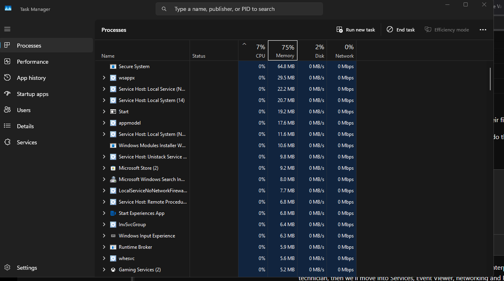

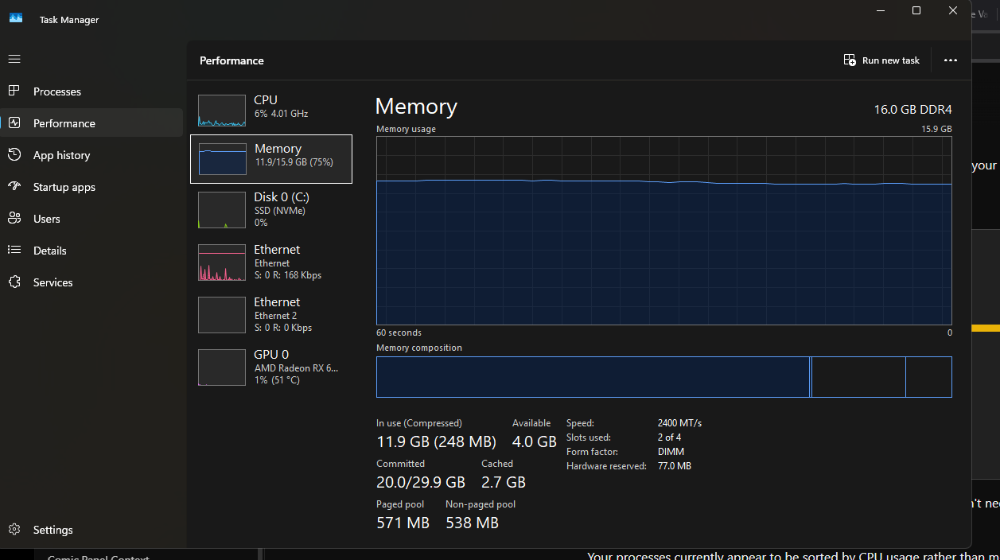

## 2. Ticket INC-0001 — Print Spooler

**Scenario:** Print jobs stuck in queue. Open `Win+R` → `services.msc` → Print Spooler properties. Service name `Spooler`, display name Print Spooler, executable `C:\Windows\System32\spoolsv.exe`, startup Automatic, initially Running. Stopped service during practice; later PowerShell showed Running again. Startup type and current state are different. Dependencies can affect startup. Automatic, delayed automatic, manual and disabled were discussed.

```powershell
Get-Service -Name Spooler
# Practiced in GUI; equivalent command taught, execution not evidenced:
Restart-Service -Name Spooler
```

**Result:** Service stopped and was subsequently observed running. No real print job was tested, so actual printer functionality was not verified.

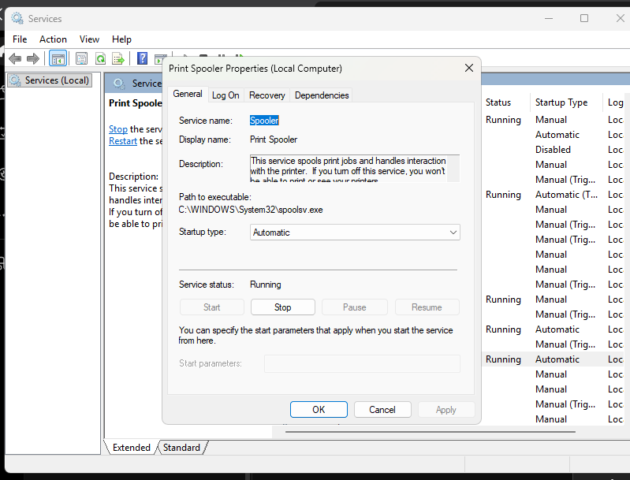

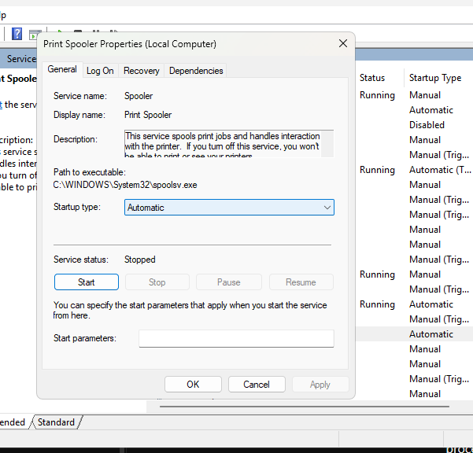

## 3. Ticket INC-0002 — Event Viewer and device security

Open `eventvwr.msc` → Windows Logs → System. Reviewed Source, Event ID, timestamp, level and description. Information, Warning, Error and Critical levels discussed. Correlate timestamps to symptoms rather than treating every red event as the cause.

**Observed event:** TPM-WMI, ID 1040, Error, November 26 at 11:52:44 AM. Pre-attestation health check reported a critical component failed and device was not expected to pass attestation. This does not establish that TPM hardware is defective or that an unexpected shutdown occurred; the shutdown ticket was simulated.

Follow-up: `tpm.msc` reported TPM ready for use (AMD); `msinfo32` showed Secure Boot On and BIOS mode UEFI. Opened `C:\Windows\Logs\MeasuredBoot\0000000703-0000000000.json` in VS Code; formatted for readability with Shift+Alt+F and searched for `false`. No diagnostic-file save was requested.

| Observed field | Actual | Desired |
|---|---|---|
| VirtualSecureMemory | false (computer and TCG log) | true |
| SecureCorePCCompliant | false (computer and TCG log) | true |
| EkCertRsa2048IsAvailable | false | true |
| EkCertEccP256IsAvailable | false | true |
| EkCertEccP384IsAvailable | false | true |
| WindowsAikCertRsa2048IsAvailable | false | true |

JSON also displayed `HealthStatus: Cannot be attested` and `TpmPresent: true`. Certificate availability is a lead, not a confirmed root cause; screenshots do not establish which checks were mandatory. No TPM clear, BIOS changes or repair performed. Follow up by checking required versus informational entries and recurrence if relevant.

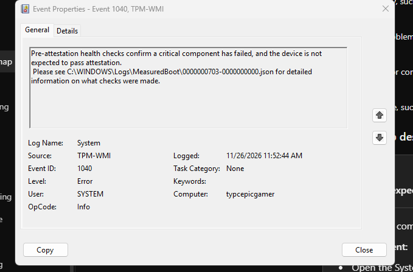

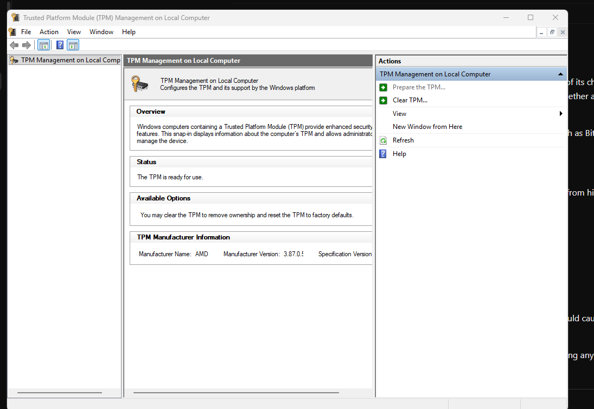

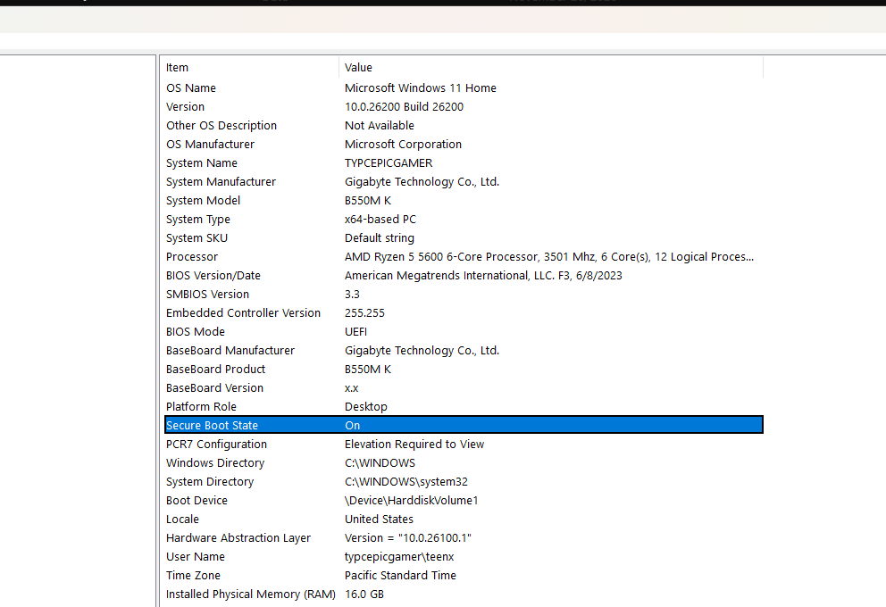

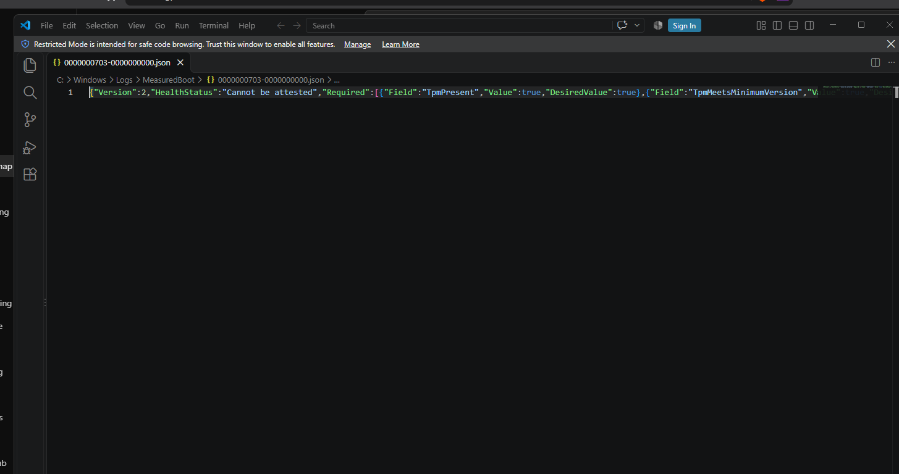

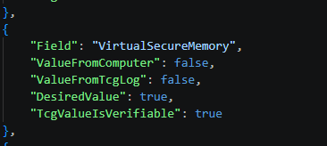

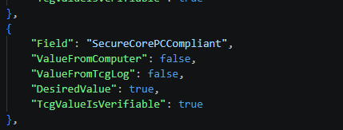

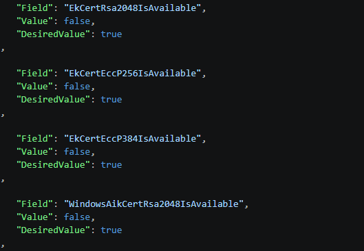

## 4. CMD and network troubleshooting

```cmd
ipconfig
ping 8.8.8.8
nslookup google.com
```

| Observation | Result |
|---|---|
| Main Ethernet IPv4 | 192.168.0.163 |
| Subnet mask | 255.255.255.0 (/24) |
| Default gateway | 192.168.0.1 (likely router) |
| Ethernet 2 | 192.168.56.1, /24, no gateway; likely virtual adapter, unverified |
| Ping | 4 sent, 4 received, 0% loss |
| Round trip | 15, 200, 17, 19 ms; displayed average 62 ms |
| DNS resolver | 1.1.1.1 (Cloudflare) |
| DNS response | Non-authoritative; one IPv6 and six IPv4 addresses |

**Concepts learned:** IPv4 vs IPv6 link-local, subnet network vs host portion, default gateway, ICMP, payload bytes, latency, packet loss, TTL, DNS resolution and non-authoritative responses. The PC address identifies a device; gateway routes to other networks. Devices on the same subnet normally communicate directly. A single latency spike is not enough to diagnose a persistent problem. Ping may be blocked even when other traffic works.

**Troubleshooting order:** inspect IP configuration → test gateway → test public IP → test DNS → investigate application. The successful public ping and lookup support connectivity at test time, not universal internet availability.

Suggested but not evidenced: `ping 192.168.0.1`, `ipconfig /all`, `tracert 8.8.8.8`, `getmac`.

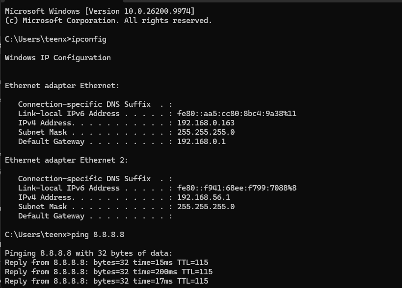

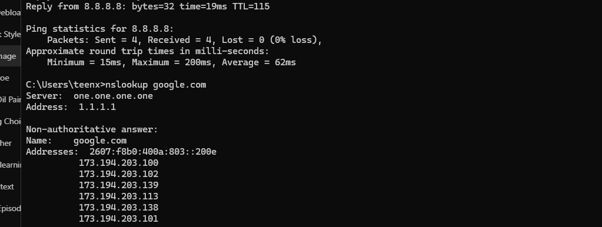

## 5. PowerShell fundamentals

Opened Windows PowerShell as administrator. Learned Verb-Noun cmdlets, parameters and arguments, objects vs plain text, pipeline (`|`), sorting and filtering.

```powershell
Get-Process
Get-Service
Get-Service -Name Spooler
Get-Process | Sort-Object WorkingSet -Descending | Select-Object -First 5
Get-Service | Where-Object {$_.Status -eq "Running"}
```

`$_` refers to current object; `.Status` is its property; `-eq` compares equality. `-Descending` sorts highest first. Process columns include PID, working set, pageable/nonpageable memory, handles, session ID and CPU seconds (cumulative, not current percent). Top working sets shown: Memory Compression 863084 KiB, Claude 655656 KiB, Brave 577712 KiB, Discord 533156 KiB, explorer 445872 KiB. These are individual processes, not application totals.

Additional taught commands, not confirmed executed:

```powershell
Get-Service | Where-Object {$_.Status -eq "Running"} | Measure-Object
Get-Service | Where-Object {$_.Status -eq "Stopped"}
Restart-Service -Name Spooler
```

An earlier `CommandNotFoundException` was visible; original command is not shown. Subsequent commands succeeded.

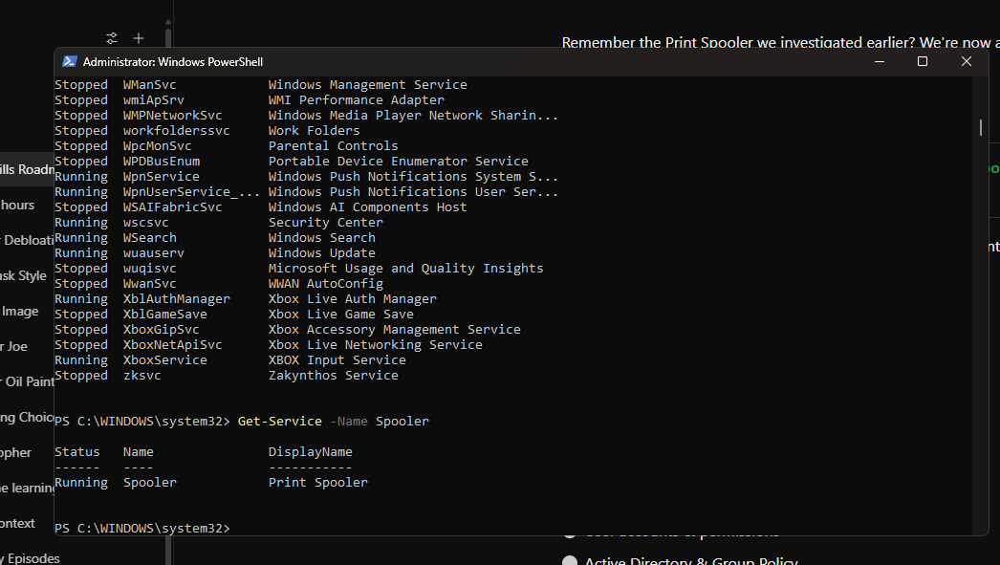

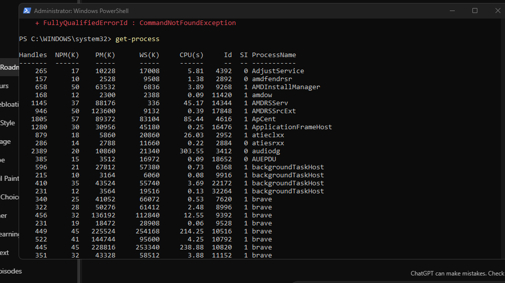

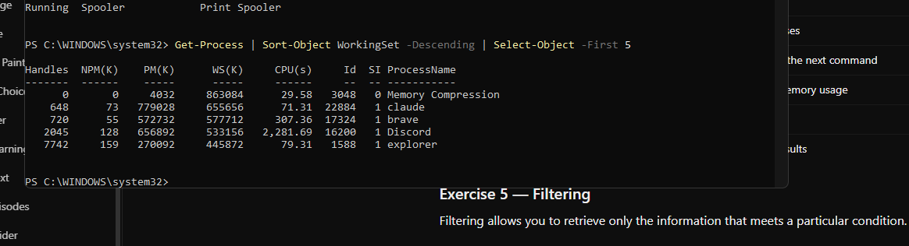

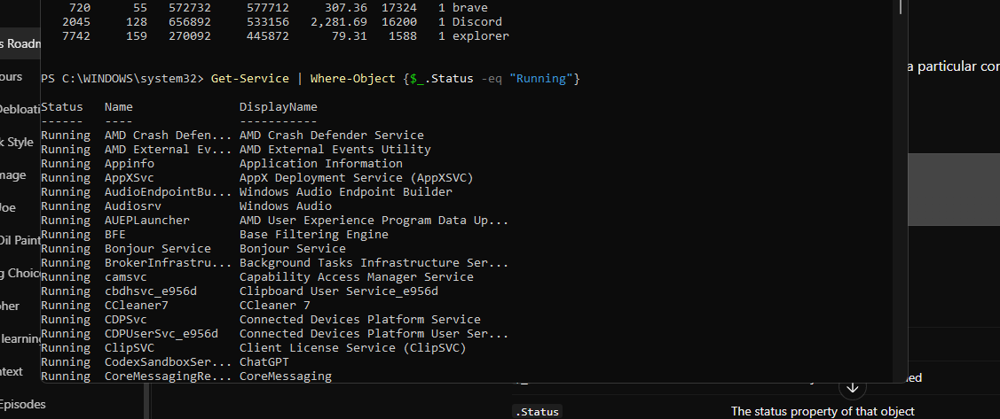

## 6. Local identities and security groups

```powershell
Get-LocalUser
Get-LocalGroup
Get-LocalGroupMember -Group "Administrators"
whoami
```

Eight initial local accounts were listed, including disabled built-in Administrator and Guest, Windows-managed accounts, two enabled apparent Codex sandbox accounts and the enabled personal Microsoft-linked account. Administrators had two members: disabled built-in Administrator and the personal account. Group membership and enabled status are separate. The personal account can elevate even though the built-in Administrator is disabled. Groups discussed: Users, Administrators, Event Log Readers, Remote Management Users, OpenSSH Users and Hyper-V Administrators (presence of group does not establish Hyper-V availability).

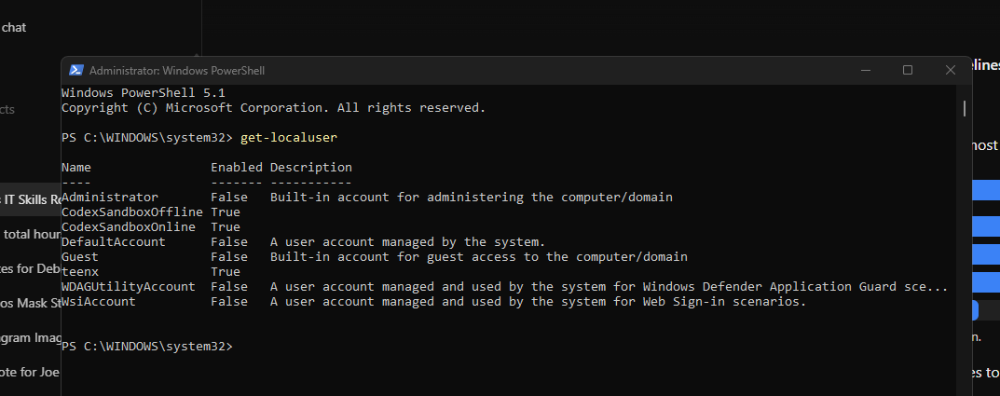

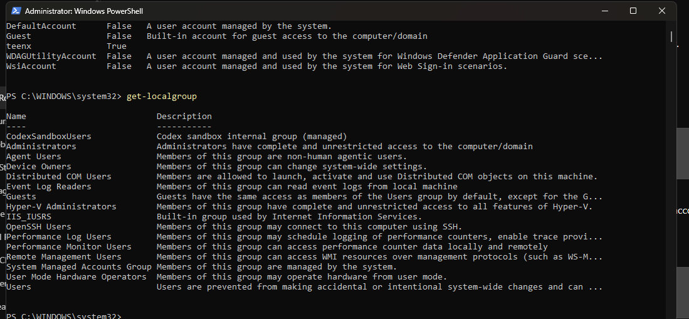

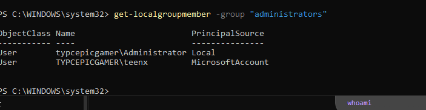

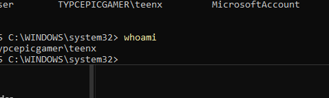

## 7. Ticket INC-0004 — Employee onboarding

Fictional employee Alex Smith, Marketing, username `alex.smith`, standard user. No administrator access granted.

```powershell
$Password = Read-Host "Enter a temporary password" -AsSecureString
New-LocalUser -Name "alex.smith" -Password $Password -FullName "Alex Smith" -Description "Marketing Employee - IT Lab"
Add-LocalGroupMember -Group "Users" -Member "alex.smith"
Get-LocalGroupMember -Group "Users"
```

**Mistakes and corrections:** Used `happy` as the prompt, initially confusing prompt text with the password. Then typed `New-LocalUser-Name` without a space, omitted `$password` after `-Password`, and left a quote unclosed. `>>` was the continuation prompt. Cancelled with Ctrl+C, retained variable, corrected syntax and successfully created the account. Actual description typed was `marketing employee IT Lab`. Membership output verified Alex in Users.

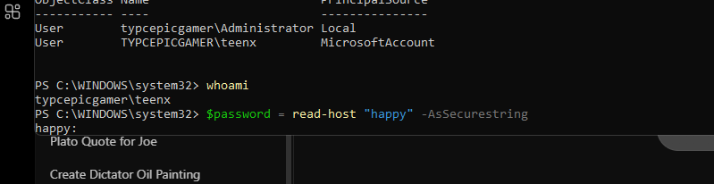

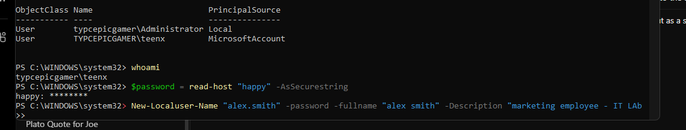

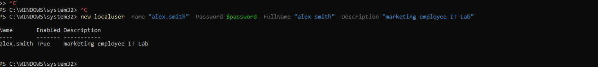

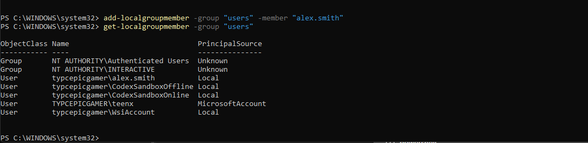

## 8. Ticket INC-0005 — Password reset

Simulated verified identity and authorized reset. No actual employee involved.

```powershell
$NewPassword = Read-Host "Enter new password" -AsSecureString
Set-LocalUser -Name "alex.smith" -Password $NewPassword
Get-LocalUser -Name "alex.smith" | Select-Object Name, PasswordLastSet
```

**Mistakes:** Missing hyphen in `AsSecureString` caused plaintext input (redacted in evidence); corrected with `-AsSecureString`. Missing hyphen before `Password` caused `ParameterBindingException`; corrected. Misspelled `selectt-object` caused `CommandNotFoundException`; corrected to `Select-Object` independently. PasswordLastSet displayed 11/26/2026 8:01:37 PM. This verifies a reset timestamp, not a successful sign-in. Never reuse the exposed practice password; if reused elsewhere, change it there too.

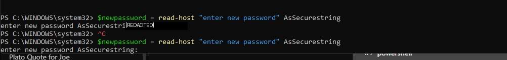

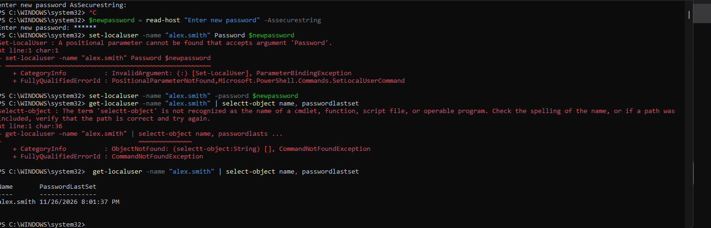

## 9. Ticket INC-0006 — Offboarding and reactivation

```powershell
Disable-LocalUser -Name "alex.smith"
Get-LocalUser -Name "alex.smith"
Enable-LocalUser -Name "alex.smith"
Get-LocalUser -Name "alex.smith"
```

Verified Enabled False, then True. Initially typed `enable-localuser name "alex.smith"` without hyphen; corrected after parameter binding error. Learned that disabling preserves account identity, unlike deletion. Real offboarding requires authorization and additional steps such as session revocation where applicable.

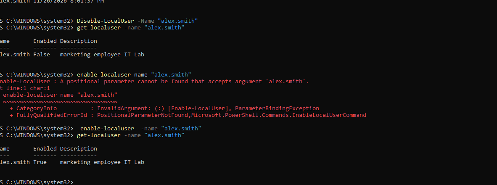

## 10. Ticket INC-0007 — NTFS departmental permissions

Created practice directories using `New-Item -ItemType Directory`:

```powershell
New-Item -Path "C:\IT-Lab" -ItemType Directory
New-Item -Path "C:\IT-Lab\HR" -ItemType Directory
New-Item -Path "C:\IT-Lab\Marketing" -ItemType Directory
New-Item -Path "C:\IT-Lab\IT" -ItemType Directory
Get-Acl -Path "C:\IT-Lab\Marketing" | Format-List
```

Explorer confirmed all three departmental folders. ACL fields: Path, Owner, Group, Access, Audit, SDDL. Initial permissions included Administrators and SYSTEM Full Control, Users Read & Execute, Authenticated Users Modify. This meant broad access to folders by default. NTFS permissions, inheritance, explicit rules, effective access and least privilege were discussed.

**Mistake:** Opened advanced security on parent `C:\IT-Lab` instead of HR. Caught before editing. Opened HR only → Properties → Security → Advanced → Change permissions → Disable inheritance → Convert inherited permissions into explicit permissions. Removed Users and Authenticated Users; preserved Administrators and SYSTEM Full Control, left child replacement unchecked, applied.

| HR principal | Before | After |
|---|---|---|
| Administrators | Inherited Full Control | Explicit Full Control |
| SYSTEM | Inherited Full Control | Explicit Full Control |
| Users | Inherited Read & Execute | Removed |
| Authenticated Users | Inherited Modify | Removed |

Verified HR via Effective Access → Select a user → alex.smith → View effective access. All 14 displayed permissions showed red X, limited by file permissions. Alex had no listed effective file permissions on HR. This is ACL evaluation, not a live sign-in test; traverse privileges and parent permissions can complicate real access. Marketing permissions were inspected, not separately restricted or tested for Alex; IT remains unrestricted in this exercise. Thus HR restriction is verified, full departmental isolation is not.

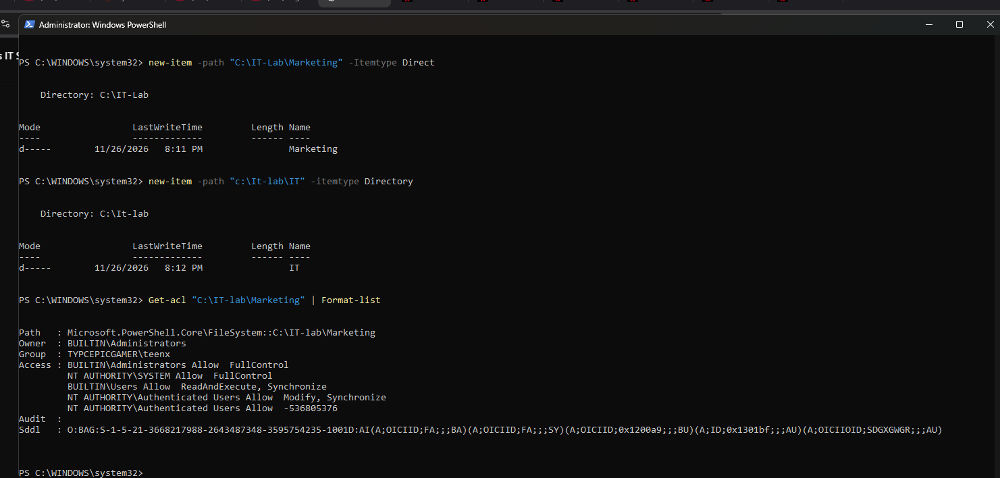

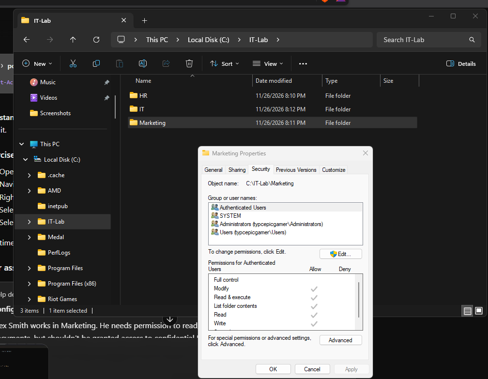

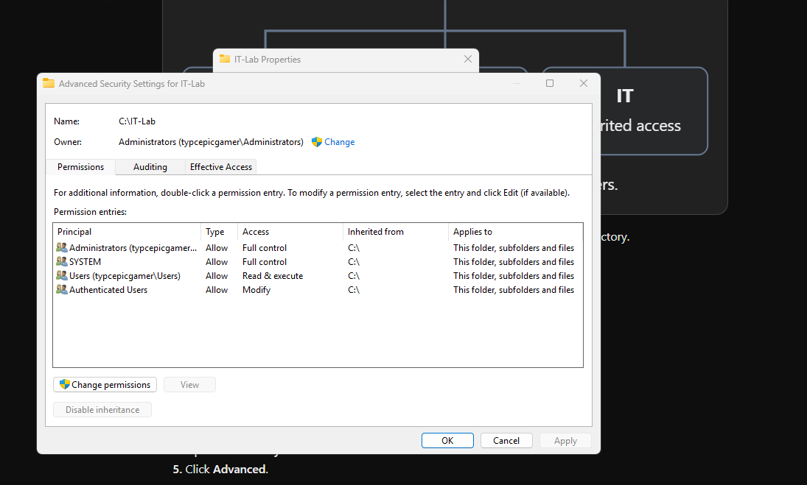

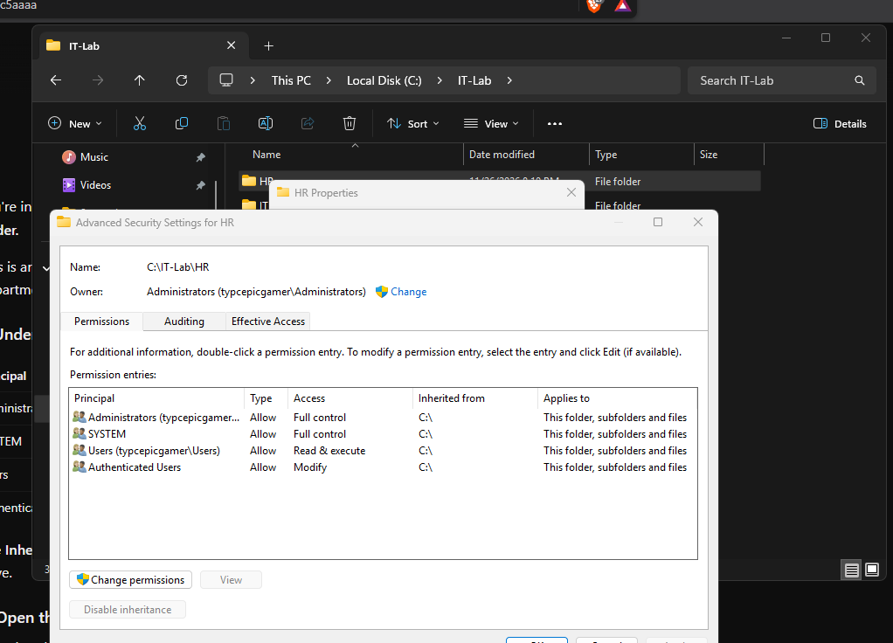

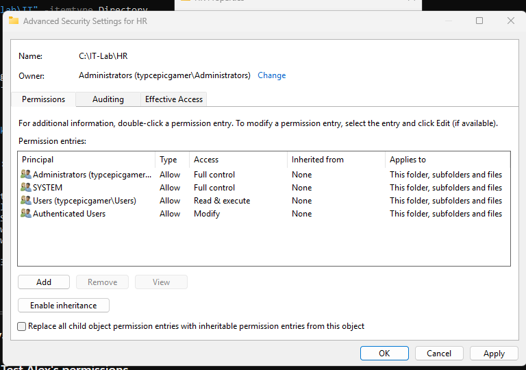

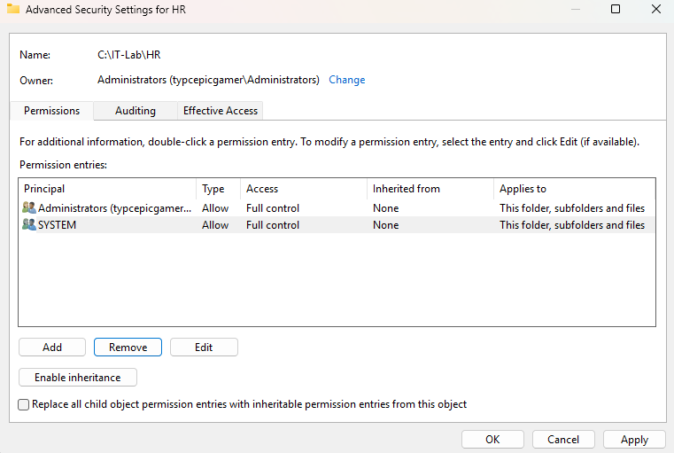

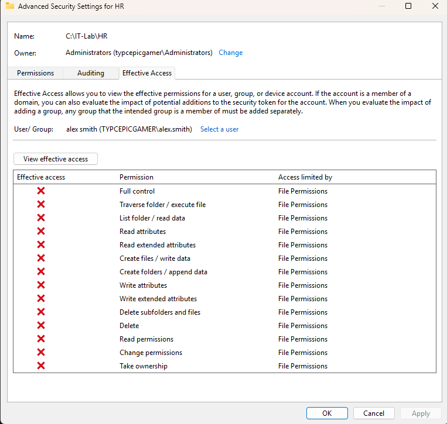

## 11. Active Directory and Group Policy — introduction

Discussed centralized identities, domain controllers, domains, organizational units, security groups, Group Policy, LDAP, Kerberos and RSAT. Example fictional domain `corp.example.com` with HR, Marketing, IT and Workstations OUs. OUs organize objects and policy scope; security groups assign access.

| Local | AD equivalent / related operation |
|---|---|
| Get-LocalUser | Get-ADUser |
| New-LocalUser | New-ADUser |
| Set-LocalUser | Set-ADUser (attributes); Set-ADAccountPassword (password reset) |
| Disable-LocalUser | Disable-ADAccount |
| Enable-LocalUser | Enable-ADAccount |
| Add-LocalGroupMember | Add-ADGroupMember |
| Get-LocalGroupMember | Get-ADGroupMember |

Windows 11 Home cannot join an AD domain or host the full Hyper-V role; no domain controller, RSAT session or GPO was configured tonight. Proposed next lab: isolated VirtualBox network, Windows Server VM running AD DS/DNS, Windows 11 Pro client VM, fictional accounts and groups, domain join and GPO validation. With 16 GB RAM, start with one server and one client and monitor memory.

## 12. Mistake log and lessons learned

| Mistake / observation | Correction / lesson |
|---|---|
| Process list sorted by CPU | Later sorted WorkingSet with PowerShell |
| Unknown TPM error | Collected evidence instead of clearing TPM; root cause unresolved |
| Prompt confused with password | Read-Host text is a label; input is stored in variable |
| Missing space between cmdlet and parameter | Separate tokens |
| Missing closing quotation mark | Recognize continuation prompt; Ctrl+C |
| Missing password variable | Pass secure string to -Password |
| Missing hyphen in AsSecureString | Correct parameter and use fresh password |
| Missing hyphen in Password and Name | Correct parameter binding errors |
| selectt-object typo | Correct command spelling; use Tab completion |
| Opened parent folder ACL | Verify target path before applying security changes |

## 13. Remaining work and next lab

- [x] Core Windows diagnostics and basic networking
- [x] PowerShell queries, variables, sorting, filtering and error correction
- [x] Local account creation, membership, reset, disable and enable
- [x] HR folder inheritance and effective access verification
- [ ] Confirm cleanup: disable practice account or remove it if no longer needed
- [ ] Optionally verify Alex's effective access to Marketing and restrict IT using departmental groups
- [ ] Practice count/filter challenge and additional network commands if desired
- [ ] Investigate TPM attestation only if relevant; no root cause claimed
- [ ] Build Lab 002: Active Directory Domain Services, DNS, domain join and Group Policy

Cleanup commands (choose one; not evidenced as executed):

```powershell
Disable-LocalUser -Name "alex.smith"
# OR, if finished with the account:
Remove-LocalUser -Name "alex.smith"
```

Keep the practice folders for future exercises if desired. Close the elevated PowerShell session when finished.

## Portfolio summary

Completed a guided Windows IT support lab covering workstation diagnostics, Windows services, event logs, network troubleshooting, PowerShell pipelines and local identity administration. Simulated onboarding, password reset and offboarding, corrected syntax errors independently, and implemented and verified restricted NTFS access to a fictional HR folder. Active Directory was introduced conceptually, with a dedicated domain lab planned next.

## Evidence

All 35 screenshots are in [`screenshots/`](screenshots/), in chronological order with descriptive filenames. Tasks not shown in screenshots are labeled as taught or not evidenced rather than completed.

[← Back to portfolio](../)
